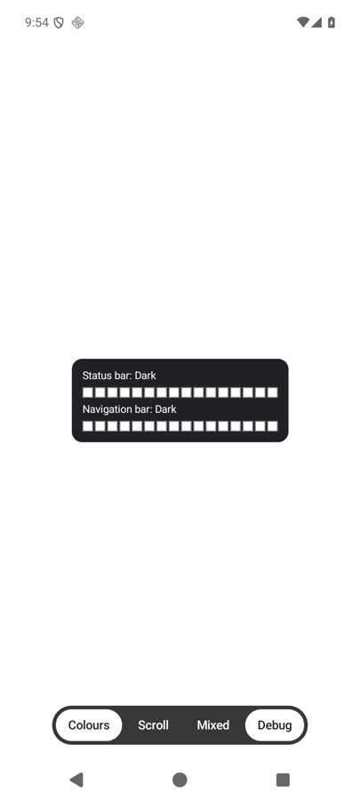
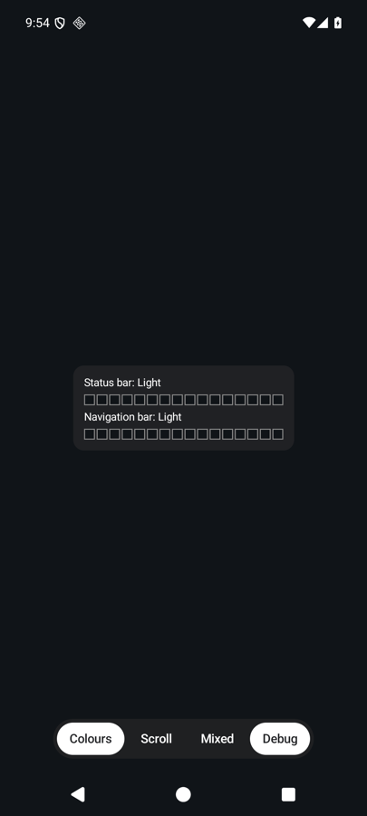
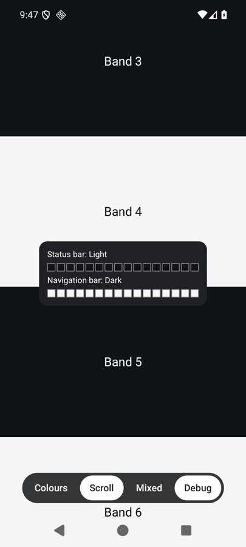
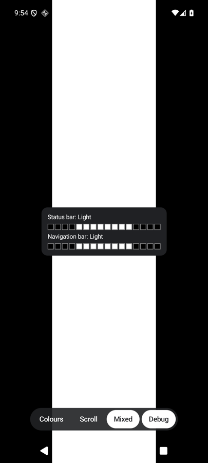

# EdgeChameleon

[](https://central.sonatype.com/artifact/dev.schattauer.edgechameleon/edgechameleon)
[](https://github.com/rschattauer/EdgeChameleon/actions/workflows/ci.yml)
[](LICENSE)

Switches the status bar and navigation bar icons between light and dark, based on the content behind the bars.

EdgeChameleon is a Compose Multiplatform library: add it to `commonMain` and call `Modifier.edgeChameleon()` from shared
UI code, without `expect`/`actual`. It is only implemented on Android, because the other targets don't need it. There the
modifier only draws its content, so the same code compiles and runs everywhere. See [Platforms](#platforms).

## Quick start

**1. Add the dependency**

In a Compose Multiplatform Gradle module (`build.gradle.kts`):

```kotlin
repositories {
    mavenCentral()
}

kotlin {
    sourceSets {
        commonMain.dependencies {
            implementation("dev.schattauer.edgechameleon:edgechameleon:<version>")
        }
    }
}
```

In an Android Gradle module (`build.gradle.kts`):

```kotlin
repositories {
    mavenCentral()
}

dependencies {
    implementation("dev.schattauer.edgechameleon:edgechameleon:<version>")
}
```

**2. Add the modifier to the root of your app content**

```kotlin
import dev.schattauer.edgechameleon.edgeChameleon

@Composable
fun App() {
    MyApp(Modifier.fillMaxSize().edgeChameleon())
}
```

**3. Draw edge-to-edge on Android**

```kotlin
class MainActivity : ComponentActivity() {
    override fun onCreate(savedInstanceState: Bundle?) {
        enableEdgeToEdge()
        super.onCreate(savedInstanceState)
        setContent { App() }
    }
}
```

The icons now follow your content.

**Requirements:** Android minSdk 23, with sampling from Android 9 (API 28); built with Compose Multiplatform 1.12; the
app draws edge-to-edge.

## Platforms

EdgeChameleon is only implemented on Android. The other targets are part of the library so that shared code can use the
modifier, and there it only draws its content; the options have no effect.

| Platform | What happens | Why |
|---|---|---|
| Android 9 (API 28) and newer | Samples the content and sets the icons | An edge-to-edge app draws behind the bars, and the icon colour does not follow the content |
| Android below 9 | Only draws the content | Not supported |
| iOS | Only draws the content | The system adapts the status bar to the content itself |
| macOS, desktop (JVM), web (JS and Wasm) | Only draws the content | No system bars are drawn over the app content |

## Screenshots

Taken from the sample app with its debug panel on, which shows the 16 sampled cells of each bar and the chosen icons.

| Light content | Dark content | Scrolling | Mixed content |
|---|---|---|---|
|  |  |  |  |
| Dark icons | Light icons | Follows what is behind each bar: light icons over a dark band, dark icons over a white one | No icon colour fits the whole bar, so an icon over a different colour can lose contrast |

## Options

```kotlin
val state = remember { EdgeChameleonState() }

Modifier.edgeChameleon(
    enabled = true,                 // false restores the original icons and stops sampling
    forcedIcons = BarIcons.Light,   // uses these icons and stops sampling
    statusBar = true,               // whether the status bar is handled
    navigationBar = true,           // whether the navigation bar is handled
    state = state,                  // state.statusBarIcons and state.navigationBarIcons hold the current result
)
```

`EdgeChameleonTuning` sets the sampling rate, cell count, contrast threshold, hysteresis and zone weights. It is marked
`@ExperimentalEdgeChameleonApi`.

## Behaviour on Android

- The content is sampled after it changes, at most 10 times per second, and not at all on a static screen.
- Each bar is reduced to 16 cells, and the cells vote for the icon colour with the better contrast. In the status bar,
  the outer quarters, where the clock and the system icons sit, count three times. In the navigation bar, every cell
  counts the same, so the whole width of the bar decides.
- Only Compose content inside the modifier is sampled.
- Sampling pauses while another window, such as a `Dialog`, has the focus, and the icons keep their tint until then.
- A full-screen `Dialog` has its own bars: add the modifier to the content of the dialog as well. It has no effect in a
  dialog that does not reach the bars.
- With gesture navigation, the navigation bar is not handled.
- While active, the navigation bar contrast scrim is turned off. It is restored when the modifier is disabled or removed.
- Disabling or removing the modifier restores the icons the app had before the library first changed them. Changes the
  app makes to the icons while the modifier is active are replaced.

## Sample

`sample/` holds an Android app with a colour screen, scrolling bands and mixed backgrounds. Its debug toggle shows the
sampled cells and the current result.

```
./gradlew :sample:androidApp:installDebug
```

## More

- [CHANGELOG.md](CHANGELOG.md): what changed in each version
- [CONTRIBUTING.md](CONTRIBUTING.md): development setup, tests, formatting and pull requests
- [SECURITY.md](SECURITY.md): how to report a vulnerability
- [RELEASE.md](RELEASE.md): how a release is made

## License

[Apache License 2.0](LICENSE)
