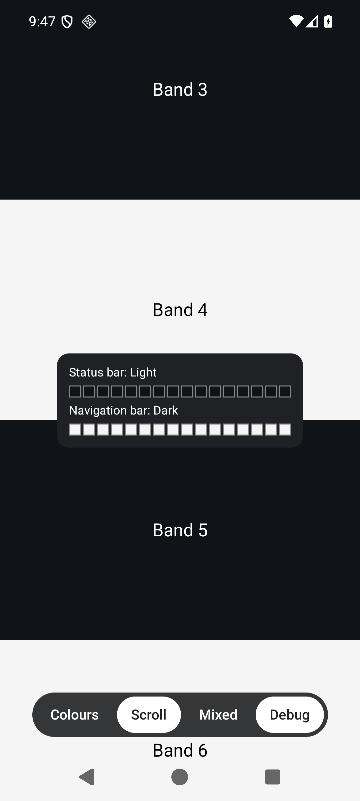

# Advanced

Everything on this page is marked `@ExperimentalEdgeChameleonApi`: it needs an opt-in, and it may change in any release,
see [RELEASE.md](../RELEASE.md). Like the rest of the library, it only does something on Android.

## Tuning

`EdgeChameleonTuning` changes how the bars are sampled and decided. Pass it as the first argument of the `tuning`
overload of the modifier. Equal tunings count as the same, so it can be created inline.

```kotlin
@OptIn(ExperimentalEdgeChameleonApi::class)
@Composable
fun App() {
    MyApp(
        Modifier.fillMaxSize().edgeChameleon(
            tuning = EdgeChameleonTuning(maxSamplesPerSecond = 20, cellCount = 24),
        )
    )
}
```

| Parameter | Default | Allowed | What it does |
|---|---|---|---|
| `maxSamplesPerSecond` | 10 | 1 to 60 | Upper limit for pixel readbacks, and so also for the time the icons need to react |
| `cellCount` | 16 | 4 to 64 | Number of cells each bar is reduced to |
| `contrastThreshold` | 0.179 | above 0, below 1 | Relative luminance below which light icons have the better contrast. At 0.179, light and dark icons have the same WCAG contrast |
| `hysteresis` | 1.25 | 1 or more | Factor by which the current result moves the threshold, so that content close to it does not make the icons flicker |
| `iconZoneWeight` | 3 | above 0 | Vote weight of the outer quarters of the status bar, where the clock and the system icons sit. Every cell of the navigation bar counts the same |
| `maxIdleIntervalMillis` | 500 | 1 to 10000 | Longest pause between two readbacks while the bars keep showing the same colours. A value that is not larger than the normal pause (1000 / `maxSamplesPerSecond` ms) turns this off |
| `samplingSource` | `Auto` | | Where the colours behind the bars are read from, see below |

A value outside its range throws an `IllegalArgumentException`.

## Sampling source

`EdgeChameleonTuning.samplingSource` decides where the colours behind the bars come from:

```kotlin
Modifier.edgeChameleon(tuning = EdgeChameleonTuning(samplingSource = SamplingSource.Window))
```

| Source | How it reads | What it sees |
|---|---|---|
| `Auto` | Lets the library choose. For now it is the same as `Content` | |
| `Content` | Records the content of the modifier into a layer, and draws the bar areas of that layer a second time, scaled down to a few pixels, which are read back | Only Compose content inside the modifier. A cell where nothing is drawn is transparent and has no vote |
| `Window` | Copies the bar areas from the frame that the window has drawn already, with `PixelCopy`, so nothing is drawn twice | Everything the window shows, including Views, content outside the modifier and the window background |

With both sources, only the part of a bar that lies under the modifier is looked at.

`Window` falls back to `Content` when the window cannot be copied, for example because it is secure, so the app never
loses its icons because of it. Hints work with both sources: a bar that hints cover completely is not read at all.

## Diagnostics

`EdgeChameleonState` can hand out what was sampled, for example to build a debug panel:

```kotlin
val state = remember { EdgeChameleonState() }
SideEffect { state.collectCells = true } // off by default, as it allocates

Modifier.edgeChameleon(state = state)

state.statusBarCells     // the colours of the cells, from left to right
state.navigationBarCells // from left to right, or from top to bottom for a navigation bar at the side
state.sampleCount        // number of pixel readbacks that gave a result so far
```

- `statusBarCells` and `navigationBarCells` hold `cellCount` colours while `collectCells` is on, and are empty
  otherwise, for a bar that is not handled, and while hints decide the bar. Setting `collectCells` back to `false`
  empties both lists.
- `sampleCount` is not observable on purpose, so showing it causes no redraw. It stands still while hints decide every
  bar, which shows that they work.

The sample app's debug panel uses all of this. Its screenshot shows the 16 cells of each bar: the status bar lies over a
dark band and has light icons, the navigation bar lies over a light band and has dark icons.



## Trace sections

The library writes `android.os.Trace` sections, which show up in a system trace (Android Studio profiler, Perfetto). The
macrobenchmark in `benchmark/` records them, see [CONTRIBUTING.md](../CONTRIBUTING.md#development-setup).

| Section | Source | What it covers |
|---|---|---|
| `EdgeChameleon.recordContent` | `Content` | Recording the content of the modifier into a layer, each time it draws. Skipped while hints cover every bar |
| `EdgeChameleon.recordSample` | `Content` | Drawing the bar areas of that layer into the small sample layer, once per sample |
| `EdgeChameleon.syncAndDraw` | `Content`, Android 10 and newer | Handing the sample layer to the renderer, which draws it into a small surface |
| `EdgeChameleon.takeFrame` | `Content`, Android 10 and newer | On the background thread `EdgeChameleon`: taking the rendered frame out of the surface |
| `EdgeChameleon.applyIcons` | both | Applying the result of a readback to the window. The number of these sections is the number of readbacks that gave a result |

While hints decide every bar, none of these sections is written.
